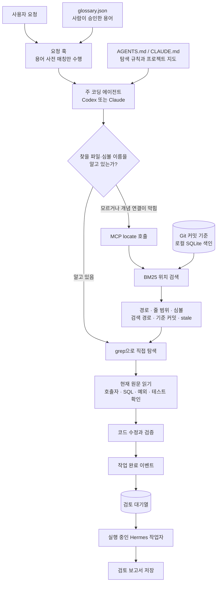
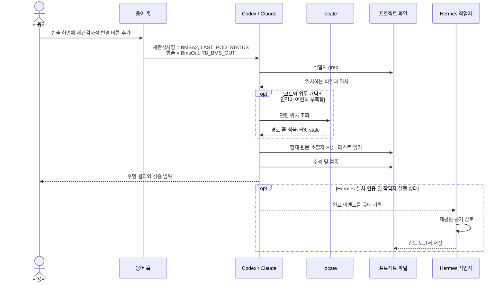

# express-server

## 개발 구성

현재 저장소의 빌드 설정 기준입니다.

- Java 11: build.gradle의 sourceCompatibility.
- Spring Boot 2.5.1: build.gradle의 플러그인 버전.
- Gradle Wrapper 7.1.1: gradle/wrapper/gradle-wrapper.properties.
- Lombok: build.gradle의 compileOnly·annotationProcessor 의존성. 버전은 의존성 관리 설정을 따릅니다.

서버 실행에 필요한 환경 설정과 외부 서비스 연결은 프로젝트 환경에 맞게 준비해야 합니다.
빌드 설정 확인만으로 서버 실행이나 업무 동작을 검증한 것은 아닙니다.

## REST API 문서

서버가 실행 중인 환경의 Swagger UI: `http://<도메인>/swagger-ui.html`.

## 프로젝트 하네스

독립 설치형 하네스의 설치·구조·명령은 [install/README.md](install/README.md)를 참고하세요.
용어 매칭과 위치 검색의 동작·설정은 [install/NAVIGATION.md](install/NAVIGATION.md)에 있습니다.

## 사용법·구조 설명 — 당시 답변 원문

> 아래는 “자세한 사용법과 구조와 그림을 그려줘” 요청에 대한 당시 답변 원문입니다. 이후 bridge와 Hermes 자동 검토 연동이 제거되었으므로, 현재 설치·운영에는 위의 [install/README.md](install/README.md)를 사용하세요. 아래 두 그림도 당시 구조를 나타냅니다.

현재 하네스는 **“Codex·Claude가 직접 코드를 탐색하고, 하네스는 용어와 위치 찾기를 돕는 구조”**입니다. 프로젝트마다 `install` 폴더를 넣어 사용할 수 있습니다.

아래 명령은 모두 **대상 프로젝트의 루트 폴더에서 실행**하는 기준입니다.

**1. 전체 구조**



각 구성요소의 역할은 다음과 같습니다.

| 구성요소 | 역할 |
|---|---|
| Codex·Claude | 탐색 범위 판단, 원문 읽기, 코드 수정, 테스트 |
| 프로젝트 지도 | 주요 모듈과 처리 흐름의 위치 안내 |
| 용어 사전 훅 | 업무 표현을 코드에서 찾을 단어로 연결 |
| `locate` | 관련 파일의 위치 후보 반환 |
| 로컬 색인 | 커밋된 코드·문서의 검색용 토큰 저장 |
| Hermes | 작업 완료 후 제한된 근거를 바탕으로 보조 검토 |

**검색 도구를 언제 호출할지는 주 에이전트가 판단합니다.** 하네스는 도구 설명과 지침으로 사용 조건을 안내하며, 에이전트의 판단을 강제로 통제하지는 않습니다.

---

**2. 폴더와 파일의 역할**

설치 후 구조를 핵심 파일 위주로 보면 다음과 같습니다.

```text
프로젝트/
├─ src/                              프로젝트 원문
├─ AGENTS.md                         Codex 지침 + 프로젝트 지도
├─ CLAUDE.md                         Claude 지침 + 프로젝트 지도
├─ .codex/
│  ├─ hooks.json                     Codex 훅 설정
│  └─ config.toml                    Codex MCP 설정
├─ .claude/
│  └─ settings.json                  Claude 훅 설정
├─ .mcp.json                         Claude 프로젝트 MCP 설정
│
└─ install/
   ├─ bootstrap.ps1 / bootstrap.sh   설치 실행 스크립트
   ├─ bootstrap.py                   설치 진입점
   ├─ installer.py                   번호 입력형 한글 설치 TUI
   ├─ configure.py                   설정·지식·용어 검토 TUI
   ├─ config.json                    프로젝트별 하네스 설정
   │
   ├─ glossary_hook.py               공통 요청 훅
   ├─ glossary.py                    용어 매칭
   ├─ locate_mcp.py                  MCP 서버: locate 하나만 노출
   ├─ navigation.py                  BM25 검색과 증분 색인
   ├─ agent_setup.py                 두 에이전트의 설정 병합
   ├─ navigation_eval.py             A/B/C 실측 기록과 요약
   │
   ├─ templates/
   │  └─ agents-root.md              두 에이전트가 공유하는 탐색 규칙
   │
   ├─ knowledge/
   │  ├─ project-map.md              주요 모듈·처리 흐름 지도
   │  ├─ glossary.json               업무 용어 ↔ 코드 식별자
   │  ├─ project.md                  프로젝트 설명
   │  ├─ testing.md                  테스트 방법과 성공 기준
   │  ├─ database.md                 데이터 구조 설명
   │  └─ decisions.md                설계·운영 결정
   │
   ├─ bridge/                       Hermes 이벤트·큐·검토 연동
   ├─ portable/                     다른 프로젝트에 배포할 중립 초기 자료
   ├─ tests/                        하네스 테스트
   │
   ├─ .venv/                        설치 시 생성하는 Python 환경
   ├─ .runtime/                     실행하면서 생성하는 상태
   │  ├─ locate/index.sqlite        검색 색인
   │  ├─ bridge/reviews/            Hermes 검토 기록
   │  ├─ agent-backups/             에이전트 설정 변경 전 사본
   │  └─ install-backups/           설치·용어 검토 변경 전 사본
   └─ dist/                         새로 만든 배포 ZIP
```

사용자가 주로 관리할 파일은 **`config.json`, `project-map.md`, `glossary.json`, 나머지 지식 문서**입니다.

`.venv`, `.runtime`, `dist`는 실행·배포 생성물입니다. 현재 저장소에서는 Git 제외 대상으로 설정했습니다.

---

**3. 처음 설치하는 방법**

먼저 Python 3.11 이상이 필요합니다. `locate`를 사용하려면 Git 저장소와 최소 한 개의 커밋도 필요합니다.

다른 프로젝트에 설치한다면 [설치 ZIP](/workspace/g1server/harness-bootstrap.zip)의 `install` 폴더를 해당 프로젝트 루트에 풉니다.

**배포 ZIP은 빈 용어 사전과 기본 지도에서 시작합니다.** 현재 g1server 작업 폴더에 작성한 `세관검사장`, `반출` 초안은 다른 프로젝트용 ZIP에 포함하지 않았습니다.

Windows에서는 다음 명령을 실행합니다.

```powershell
.\install\bootstrap.ps1 -Tui
```

Linux·macOS에서는 다음과 같습니다.

```sh
sh install/bootstrap.sh --tui
```

Python으로 직접 실행할 수도 있습니다.

```sh
python install/bootstrap.py --tui
```

화면은 다음 순서로 진행됩니다.

```text
프로젝트 하네스 설치 — Codex / Claude 공통

[1/3] 탐색 방식
1 A: 지도 + 에이전트의 grep/원문 읽기
2 B: A + 검토된 용어 별칭 훅
3 C: B + 필요할 때 호출하는 BM25 locate (권장)

선택 [3]:

[2/3] 검색 제외와 용어 사전
추가 제외 패턴:
용어 사전: 검토 완료 N개 / 검토 대기 N개

[3/3] 변경 미리보기
생성할 환경과 상태 폴더
병합할 에이전트 설정
적용할 탐색 방식

1 설치 / 2 취소 [2]:
```

일반적인 사용은 **3번 C**를 선택하면 됩니다. 마지막 화면에서 Enter만 누르면 기본값인 취소가 선택됩니다.

추가 제외 패턴은 예를 들어 다음처럼 입력합니다.

```text
private/**, legacy/generated/**, internal-credentials/**
```

설치는 기존 사용자 지침과 다른 훅·MCP 설정을 보존하면서 하네스 설정을 병합합니다. 같은 이름의 다른 MCP 설정이 있으면 덮어쓰지 않고 중단합니다.

| 설치 결과 | 의미 |
|---|---|
| 종료 코드 `0` | 설치 검사 통과 |
| 종료 코드 `2` | 설치됐으며 프로젝트 지식 검토가 남아 있음 |
| `WAITING_GIT_COMMIT` | Git 또는 첫 커밋이 없어 `locate` 준비 대기 |

설치 계획만 확인하거나 현재 설정으로 다시 설치할 때는 다음 명령을 사용합니다.

```powershell
.\install\bootstrap.ps1 -Plan
.\install\bootstrap.ps1 -Execute
```

---

**4. 프로젝트 지도와 용어 사전 준비**

두 파일은 서로 다른 역할입니다.

| 파일 | 답하는 질문 | 예시 |
|---|---|---|
| `project-map.md` | “어느 모듈을 먼저 봐야 하지?” | 반출 API → BmsOutController → BmsOutService |
| `glossary.json` | “업무 표현을 코드에서 무슨 단어로 찾지?” | 세관검사장 → BMSA2, LAST_POD_STATUS |

지도에는 모든 코드를 설명하기보다 주요 위치와 연결을 짧게 적습니다.

```markdown
## 프로젝트 지도

- HTTP 진입점: src/controller/
- 업무 서비스: src/service/
- 데이터 접근: src/mapper/
- SQL 정의: resources/mapper/
- 반출: BmsOutController → BmsOutService → BmsOutMapper
- 공통 상태 코드: model/bms/BmsConsts.java
```

지도를 수정한 후에는 루트 지침에 다시 반영합니다.

```sh
python install/harness.py install-guidance --execute
```

이 명령은 `AGENTS.md`와 `CLAUDE.md`의 하네스 관리 블록을 갱신합니다.

용어 사전은 다음 형태입니다. 아래 근거 위치는 현재 g1server 초안의 예입니다.

```json
{
  "version": 1,
  "entries": [
    {
      "term": "세관검사장",
      "aliases": ["세관 검사장"],
      "symbols": [
        "BMSA2",
        "LAST_POD_STATUS",
        "updateCustomsInspect"
      ],
      "reviewed": false,
      "evidence": [
        {
          "path": "src/main/java/org/yht/exps/express/model/bms/BmsConsts.java",
          "line": 163
        }
      ]
    }
  ]
}
```

| 항목 | 의미 |
|---|---|
| `term` | 대표 업무 용어 |
| `aliases` | 띄어쓰기나 표현이 다른 동의 표현 |
| `symbols` | 에이전트가 grep할 코드 식별자 |
| `reviewed` | 사람이 근거를 검토했는지 |
| `evidence` | 검토할 원문 위치 |

초안을 작성한 뒤 검토 화면을 엽니다.

```sh
python install/configure.py --glossary
```

화면에는 용어와 근거 주변 원문이 표시됩니다.

```text
세관검사장 = BMSA2, LAST_POD_STATUS, updateCustomsInspect

.../BmsConsts.java:163
  163: public String BMSA2 = "BMSA2"; // 세관검사장

원문과 의미를 검토했으면 REVIEW, Enter는 보류:
```

`REVIEW`를 입력하면 해당 항목이 활성화됩니다. Enter는 보류입니다.

현재 구현은 **지도·용어를 자동으로 추출해 승인하는 기능까지 제공하지 않습니다.** 에이전트나 사람이 초안을 작성하고, 검토 화면에서 사람이 승인하는 방식입니다. 승인한 용어의 의미가 변경되면 사전을 수정하고 다시 검토해야 합니다.

---

**5. Codex·Claude에서 실제로 사용하는 흐름**

설치 후 앱을 다시 열고 프로젝트 훅과 `project-harness-locate` MCP가 인식됐는지 확인합니다. MCP 프로세스는 클라이언트가 설정된 명령으로 실행하므로 별도로 서버 터미널을 띄울 필요는 없습니다.

예를 들어 다음 요청을 보냅니다.

> 반출 화면에 세관검사장 변경 버튼을 추가해줘.

관련 사전을 승인해 둔 경우의 흐름입니다.



용어가 매칭되지 않으면 요청 훅은 추가 문맥을 넣지 않습니다. 이때도 에이전트는 지도를 보고 탐색하거나 필요하면 `locate`를 호출할 수 있습니다.

앱 연결을 처음 점검할 때는 에이전트에게 다음처럼 명시적으로 요청할 수 있습니다.

> 연결된 locate 도구로 “세관검사장 변경”의 위치 후보를 찾아줘. 아직 수정하지 말고 후보의 현재 원문을 확인해줘.

이것은 도구 연결 확인용 요청입니다. 평소에는 작업을 자연어로 요청하면 됩니다.

---

**6. `locate`를 직접 실행하고 결과 읽기**

앱과 별개로 검색 자체를 확인하려면 다음 명령을 사용합니다.

```sh
python install/navigation.py locate "세관검사장 변경" --limit 5
```

결과 항목은 다음 형태입니다.

```json
{
  "path": "src/main/java/org/yht/exps/express/service/bms/BmsOutService.java",
  "start_line": 1741,
  "end_line": 1820,
  "symbol": "updateOutScan | updateCustomsInspect",
  "via": ["bm25"],
  "index_commit": "f777ef5b905bd45e2a02a8937b41f512f021b9f6",
  "stale": false,
  "stale_reason": null
}
```

| 항목 | 읽는 방법 |
|---|---|
| `path` | 직접 열어볼 파일 |
| `start_line`, `end_line` | 검색에 사용된 원문의 후보 범위 |
| `symbol` | 해당 범위의 심볼 이름 요약 |
| `via` | `bm25` 또는 `glossary` + `bm25` |
| `index_commit` | 검색 색인의 기준 커밋 |
| `stale` | 현재 작업 파일이 색인 원문과 다른지 |
| `stale_reason` | `modified` 또는 `deleted` |

`symbol`은 정밀 AST 분석 결과가 아니라 탐색을 돕는 이름 요약입니다. **응답에 코드 본문은 없으므로 실제 파일을 열어 확인해야 합니다.**

인덱스와 작업 파일의 관계도 알아두면 좋습니다.

| 상황 | 동작 |
|---|---|
| 첫 검색 | 커밋된 허용 파일을 인덱싱 |
| 커밋 변화 없음 | 기존 색인 사용 |
| 새 커밋 발생 | 변경된 Git blob만 다시 인덱싱 |
| 기존 파일을 수정했지만 미커밋 | 이전 커밋 기준 후보에 `stale: true` |
| 기존 파일을 삭제했지만 미커밋 | 후보에 `stale_reason: deleted` |
| 새 파일을 만들었지만 미커밋 | 색인에 없음. grep·파일 목록으로 확인 |
| 제외 설정 변경 | 정책을 반영해 색인을 갱신하고 제외된 자료 제거 |

필요하면 미리 색인을 갱신할 수 있습니다.

```sh
python install/navigation.py index
```

현재 검색은 BM25와 한국어 n-gram을 사용합니다. Qdrant나 임베딩 기반 의미 검색은 포함하지 않습니다.

---

**7. 프로젝트 지식과 Hermes 운영**

프로젝트 설명, 테스트 기준, 데이터 구조 등을 정리하려면 다음 TUI를 사용합니다.

```sh
python install/configure.py
```

이 화면에서는 소스 범위와 보호 패턴, 선택적인 테스트 명령, 지식 문서를 설정합니다.

소스 변경 이후 수동 문서를 관리하는 순서는 다음과 같습니다.

```powershell
.\install\run.ps1 sync

# 변경 목록과 현재 원문을 확인하고 관련 지식 문서 수정

.\install\run.ps1 accept-review --note "반출 처리와 SQL 변경을 문서에 대조함"
```

**용어 승인과 지식 검토 승인은 별개입니다.**

- `configure.py --glossary`: 특정 용어와 코드 식별자의 대응을 승인합니다.
- `accept-review`: 현재 소스에 대해 수동 지식을 검토했다는 기준을 기록합니다.

지식 검토 대기가 남아 있어도 `locate`의 위치 검색 자체는 사용할 수 있습니다.

Hermes를 사용할 때는 별도 설치·인증이 필요합니다. Windows 기준입니다.

```powershell
# Hermes가 아직 없을 때
.\install\install-hermes.ps1 -Execute

# 모델과 인증 설정
hermes setup

# 검토 작업자 시작
.\install\bridge.ps1 start

# 상태 확인
.\install\bridge.ps1 status
```

운영 중에는 다음 명령을 사용합니다.

```powershell
.\install\bridge.ps1 status --json
.\install\bridge.ps1 retry
.\install\bridge.ps1 stop
```

`retry`는 실패 원인을 해결한 후 사용합니다. Linux·macOS에서는 대응하는 `bridge.sh`를 실행합니다.

보고서는 다음 폴더에서 확인합니다.

```text
install/.runtime/bridge/reviews/
```

Hermes는 제공된 일부 원문과 이벤트를 바탕으로 검토합니다. 검토 결과가 모든 호출자나 업무 동작의 정확성을 보증하지는 않습니다. 보고서는 저장되며, 다음 요청에 자동으로 주입되지 않습니다.

---

**8. 다른 프로젝트에 배포하기**

현재 프로젝트에서 사용하던 `.venv`, `.runtime`, 업무 사전을 통째로 복사하는 대신 배포 명령을 실행합니다.

```sh
python install/build_bundle.py
```

생성되는 파일은 다음과 같습니다.

```text
install/dist/
├─ harness-bootstrap.zip
├─ harness-bootstrap.files.txt
└─ harness-bootstrap.sha256
```

배포 ZIP에는 공통 코드와 `portable`의 초기 자료가 들어갑니다. 현재 프로젝트의 실행 기록, 인증 설정, 승인된 업무 지식은 포함하지 않습니다.

따라서 다른 프로젝트에서는 다음 순서로 시작합니다.

```text
ZIP 해제
  → 한글 TUI 설치
  → 해당 프로젝트 지도 작성
  → 용어 사전 초안 작성·검토
  → 앱의 훅/MCP 연결 확인
  → 실제 작업에 사용
```

같은 프로젝트를 다른 컴퓨터로 옮기는 경우에는 프로젝트별 지도·용어 사전·지식 문서를 별도로 보존하고, `.venv`는 새 환경에서 다시 만듭니다.

---

**9. 효과 측정과 현재 검증 범위**

TUI의 A/B/C 모드는 다음 세 조건을 비교하기 위한 것입니다.

| 조건 | 구성 |
|---|---|
| A | 지도 + 에이전틱 탐색 |
| B | A + 용어 매칭 훅 |
| C | B + `locate` |

현재 A/B에서도 MCP 등록 자체는 유지되며, 비활성화된 `locate`는 `DISABLED`를 반환합니다. 도구가 보이는 영향까지 비교하려면 A/B 측정 세션에서는 앱에서 해당 MCP를 비활성화해야 합니다.

실측 결과는 다음 명령으로 기록하고 요약합니다.

```sh
python install/navigation_eval.py record install/.runtime/navigation-trials.jsonl --input trial.json

python install/navigation_eval.py summary install/.runtime/navigation-trials.jsonl
```

측정 항목은 놓친 호출자, 부족한 근거, Hermes 지적 건수, 입력·출력 토큰, 소요 시간, 막혔을 때 `locate`를 호출했는지입니다. 미측정 값은 `null`로 기록합니다.

현재 확인한 범위는 다음과 같습니다.

- **30개 테스트 통과**
- 임시 프로젝트에서 TUI 설치·반복 설치·기존 설정 보존 확인
- 생성된 설정으로 훅과 MCP 프로세스 실제 호출
- 보호 파일 제외, 증분 갱신, 변경·삭제 파일 표시 확인
- 배포 ZIP 해제 후 실제 설치 확인
- g1server에서 세관검사장 관련 Controller·Service·Mapper·SQL 위치 확인

실제 Codex·Claude 앱에서의 수신, Windows 실행, Hermes 모델 호출, A/B/C 작업 품질 비교는 아직 별도 검증이 필요합니다.

파일로 된 안내는 [설치·운영 설명](/workspace/g1server/install/README.md)과 [검색·보호·측정 설명](/workspace/g1server/install/NAVIGATION.md)에서 볼 수 있습니다.
