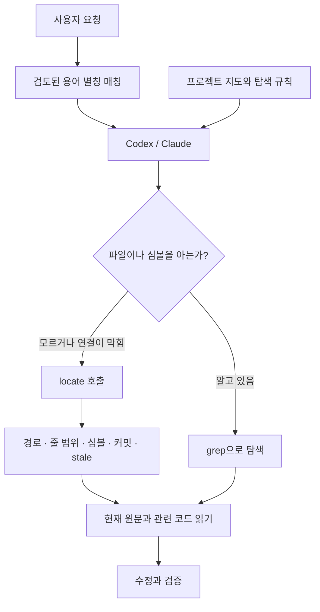

# Portable Codex + Claude harness

프로젝트에 `install` 폴더를 놓고 사용하는 Python 3.11+ 기반 하네스입니다.
주 에이전트의 원문 탐색을 돕는 프로젝트 지도, 용어 매칭 훅, BM25 위치 검색을 제공합니다.
코어는 Python 표준 라이브러리만 사용하며, 위치 검색에는 Git 저장소와 첫 커밋이 필요합니다.
아래 명령은 프로젝트 루트에서 실행합니다. POSIX 환경에서 `python` 명령이 없으면 `python3`를 사용하세요.

## 문서와 파일 구조

| 파일 | 용도 |
|---|---|
| [NAVIGATION.md](NAVIGATION.md) | 위치 검색·용어 사전·제외 정책·측정 절차 |
| [AGENTS.md](AGENTS.md) | 하네스 작업 지침 |
| [knowledge/project-map.md](knowledge/project-map.md) | 루트 에이전트 지침에 들어갈 프로젝트 지도 |
| `knowledge/glossary.json` | 업무 용어와 코드 식별자의 대응·검토 여부 |
| `knowledge/project.md`, `testing.md`, `database.md`, `decisions.md` | 사용자가 작성·검토하는 프로젝트 지식 |
| `config.json` | 소스 범위, 보호 패턴, 탐색 설정, 선택적인 실행 명령 |

```text
install/
├─ bootstrap.py / bootstrap.ps1 / bootstrap.sh  설치 진입점
├─ installer.py                               한글 설치 화면
├─ configure.py                               설정·지식·용어 검토 화면
├─ agent_setup.py                             프로젝트 훅·MCP 설정 병합
├─ glossary.py / glossary_hook.py              용어 매칭과 요청 훅
├─ locate_mcp.py / navigation.py               locate MCP와 검색 엔진
├─ harness.py                                 지식 검토·작업 기록·검사 CLI
├─ verify_search.py / navigation_eval.py       검색 확인·실측 결과 요약
├─ templates/                                 공통 에이전트 지침
├─ knowledge/                                 현재 프로젝트의 지도·사전·지식
├─ portable/                                  새 프로젝트용 초기 자료
├─ tests/                                     하네스 테스트
├─ .venv/                                     설치 시 생성하는 Python 환경
├─ .runtime/                                  색인·실행 기록·복구 사본
└─ dist/                                      배포 명령으로 만드는 ZIP
```

`knowledge`는 현재 프로젝트의 편집 대상이고, `portable/knowledge`는 다른 프로젝트에 배포할 초기 자료입니다.
배포 명령은 두 용도를 구분해 현재 프로젝트의 업무 지식·승인 상태를 새 프로젝트로 옮기지 않습니다.

## 한글 TUI 설치

대상 프로젝트 루트에 `install` 폴더를 놓고 실행합니다. 기존 프로젝트의 지식·개인 설정은 보존하세요.

```powershell
.\install\bootstrap.ps1 -Tui
```

```sh
sh install/bootstrap.sh --tui
# 또는
python install/bootstrap.py --tui
```

설치 화면은 **탐색 방식 → 추가 보호 패턴·사전 현황 → 변경 미리보기 → 설치/취소** 순서입니다.
탐색 방식은 A(지도), B(A+용어 훅), C(B+locate) 중 선택하며 기본값은 C입니다.
마지막 설치 확인은 `1`이고 기본값 `2`는 취소입니다. 설치 전에 취소하면 파일을 변경하지 않습니다.

```sh
python install/bootstrap.py --plan     # 변경 없이 계획 확인
python install/bootstrap.py --execute  # 현재 설정으로 비대화형 설치
```

Windows 래퍼의 대응 옵션은 `-Plan`, `-Execute`입니다.
인수 없이 실행하면 터미널에서는 TUI, 파이프/CI에서는 계획을 표시합니다.
Python 환경은 `--without-pip`으로 생성합니다.
`setup.ps1`/`setup.sh`는 환경·지침·색인만 구성하는 코어 설치용입니다. 훅과 MCP까지 연결할 때는 위 bootstrap을 사용하세요.

설치 결과는 다음과 같이 확인합니다.

| 결과 | 의미 |
|---|---|
| 종료 코드 0 | 설치 검사 통과 |
| 종료 코드 2 | 설치됐으며 프로젝트 지식 검토 대기 |
| 설치 검사 내부 `WAITING_GIT_COMMIT` | Git 또는 첫 커밋 대기; 직접 탐색은 가능 |
| 그 외 오류 | 출력된 오류를 해결한 뒤 다시 설치 |

## 에이전트 연결과 작업 흐름

설치 시 루트 `AGENTS.md`/`CLAUDE.md`의 관리 블록과 다음 설정을 병합합니다.

| 클라이언트 | 요청 훅 | MCP |
|---|---|---|
| Codex | `.codex/hooks.json` | `.codex/config.toml` |
| Claude | `.claude/settings.json` | `.mcp.json` |

공통 MCP 이름은 `project-harness-locate`이며 `locate` 도구 하나를 제공합니다.
하네스가 등록하는 이벤트는 `UserPromptSubmit`입니다. 승인된 용어가 매칭되면 별칭을 반환하고, 없으면 `{}`를 반환합니다.
앱을 다시 열고 프로젝트 MCP/훅 신뢰를 확인하세요. Codex 훅은 사용 중인 클라이언트 버전의 지원 여부를 확인해야 합니다.



재설치는 이전 관리 훅을 정리하고 현재 용어 훅을 등록합니다. 사용자 훅과 다른 MCP 설정은 보존합니다.
같은 이름의 사용자 MCP와 충돌하면 덮어쓰지 않습니다.
변경 전 사본은 `.runtime/agent-backups`와 `.runtime/install-backups`에 저장하며 과거 실행 기록은 자동 삭제하지 않습니다.

## 지도·용어·지식 준비

[knowledge/project-map.md](knowledge/project-map.md)에 모듈 위치와 처리 흐름을 적습니다.
초안은 사람이 작성하거나 에이전트에게 요청해 준비합니다. 지도와 사전 추출은 설치 프로그램이 자동 수행하지 않습니다.
지도를 수정한 뒤 공통 템플릿과 함께 두 에이전트의 지침에 반영합니다.

```sh
python install/harness.py install-guidance --execute
python install/configure.py --glossary
python install/configure.py
```

`--glossary`는 사전 항목의 근거 주변 원문을 표시하고 `REVIEW` 입력으로 승인합니다. Enter는 보류입니다.
일반 configure는 소스 범위·검사 명령·지식 문서 편집, 변경 검토, 위치 검색 확인을 제공합니다.
새 프로젝트용 ZIP은 빈 용어 사전과 지도 템플릿으로 시작합니다.

수동 지식 문서를 검토하는 순서는 다음과 같습니다.

```sh
python install/harness.py sync
# knowledge/generated/review-queue.md와 관련 원문·문서를 확인하고 수정
python install/harness.py accept-review --note "실제 검토한 내용"
```

`review-queue.md`는 사람이 확인할 변경 목록입니다.
`accept-review`는 검토 시점의 파일 해시를 기록합니다. 문서의 의미가 정확한지는 검토자가 판단합니다.
용어 항목 승인, 수동 지식 검토 기준, Git 커밋 기준 위치 색인은 별개입니다. 수동 지식 검토 대기는 locate를 차단하지 않습니다.

## 위치 검색과 직접 확인

```sh
python install/navigation.py locate "업무 개념" --limit 5
python install/navigation.py index
python install/verify_search.py --query "커밋된 소스의 단어"
```

첫 설치/검색, 새 커밋, 설정 변경 때 색인을 갱신합니다. 같은 정책에서는 바뀐 Git blob만 다시 토큰화합니다.
결과는 경로·줄 범위·심볼·검색 경로·기준 커밋·stale입니다. 현재 파일을 읽고 수정하세요.
Git/첫 커밋이 없는 상태에서 위 검색 CLI를 실행하면 `UNAVAILABLE`을 반환합니다.

`search-docs`/`index-docs`는 같은 locate 엔진을 호출하는 호환 CLI입니다.
`search-code`/`read-code`는 직접 원문을 찾고 읽는 CLI이며 MCP 도구 목록에는 포함하지 않습니다.
자세한 결과 형식과 제외 범위는 [NAVIGATION.md](NAVIGATION.md)를 참고하세요.

## 작업 기록과 선택적인 검사

`harness.py`에는 다음 명령도 있습니다. 상세 인수는 각 명령의 `--help`로 확인합니다.

| 명령 | 현재 동작 |
|---|---|
| `doctor`, `verify-install` | 로컬 도구·설치 상태 확인 |
| `task`, `session`, `evidence` | 목표·진행·근거를 직접 기록하고 작업 인계 Markdown 생성 |
| `run-check build`, `run-check test` | `config.json`의 commands에 등록한 명령 실행 |
| `check-build`, `run-tests` | Gradle Java 컴파일 및 등록된 JUnit 클래스 검사 |
| `db-inspect`, `db-request`, `db-capture`, `db-capture-objects` | MSSQL 스키마 조회·조회 요청 작성·결과 파일 기록용 어댑터 |

```sh
python install/harness.py run-check test
python install/harness.py run-check test --execute
```

등록된 검사 명령은 `--execute` 없이 계획만 표시합니다. 실행 로그·결과는 `.runtime/runs`에 저장합니다.
작업 기록은 명시적으로 호출할 때 갱신됩니다. `DONE`과 명령 종료 성공은 업무 테스트 전체 통과를 의미하지 않습니다.
Gradle·DB 명령은 해당 프로젝트의 도구·설정·권한이 있어야 사용할 수 있습니다.

## 검증과 배포

```sh
python -m unittest discover -s install/tests -v
python install/build_bundle.py
```

테스트는 임시 프로젝트에 설치하고 훅·MCP 프로세스를 호출합니다.
Windows PowerShell 실행과 실제 앱의 도구 수신은 각 환경에서 확인합니다.
배포 결과는 `install/dist/harness-bootstrap.zip`, 파일 목록, SHA256이며 ZIP 안에는 해시 manifest가 포함됩니다.
공통 코드와 portable 초기 자료만 배포하고 `.venv`, `.runtime`, 생성 지식, 개인 설정은 제외합니다.
현재 저장소의 설치 생성물은 `.gitignore`에 따라 Git에서 제외합니다.
A/B/C 실측 결과 기록·요약 방법은 [NAVIGATION.md](NAVIGATION.md)에 있습니다.
